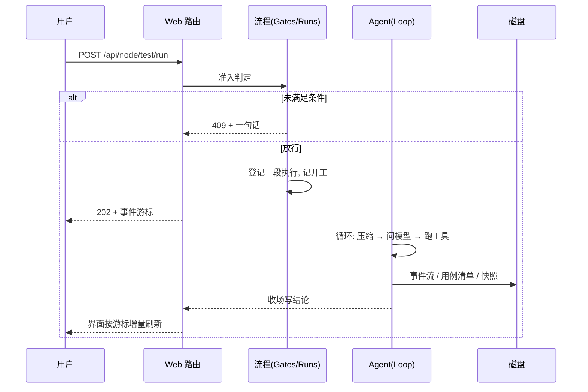

<h1 align="center">specflow</h1>

<p align="center">
  <b>给 AI 一个项目，让它按五步把活干完——每一步都交出可复核的产物</b>
</p>

<p align="center">
  <a href="#五步与闸">五步与闸</a> ·
  <a href="#技术栈">技术栈</a> ·
  <a href="#快速开始">快速开始</a> ·
  <a href="#环境配置">环境配置</a> ·
  <a href="#命令行">命令行</a> ·
  <a href="#测试">测试</a> ·
  <a href="#已知限制">已知限制</a>
</p>

<p align="center">
  
  
  
  
  
  
  
</p>

<p align="center">
  <code>① 环境 ──▶ ② 上下文 ──▶ ③ 用例 ──▶ ④ 开发 ──▶ ⑤ 测试</code>
</p>

---

给一个项目目录和一段改动需求，specflow 把活拆成五步：搭容器环境、摸清代码、写验收用例、改真代码、在容器副本里逐条验。每一步都落成能直接打开的文件，过不了闸就退回上一步。做给要接手陌生项目的人用，也给想看清「AI 到底改了什么、凭什么说验过了」的人用。

现状：能在 Windows 11 + Docker Desktop + DeepSeek API 上完整跑通一条链路，后端 231 例单测、前端 11 例、七页浏览器冒烟；没有 CI，也没有自动化端到端脚本。代码在 `master` 分支，旧版按 `v2-final` tag 取。

## 五步与闸


一次点按钮之后发生什么：



- 闸的判据只有一份，在 `src/main/java/com/specflow/flow/Gates.java`，界面只显示它给出的那句话，不自己判断。
- ② 的 `changes` 是 ④ 的写白名单：要改的文件和要新建的文件都列在这里，漏列的文件 ④ 动不了。
- ⑤ 跑在项目副本 + 容器里，源码在验收阶段冻结，跑完要你点「接受」才算闭环。

## 技术栈

| 层 | 选型 | 为什么 |
| --- | --- | --- |
| 语言 | Java 17 | records 与文本块让数据类写起来很薄 |
| Web | Spring Boot 3.5，只引 starter-web | 内嵌 Tomcat 一行起；不引 JPA / Security，暴露面越小越好 |
| 模型 | LangChain4j（OpenAI 兼容） | 只用一个 `chat()` 调用，协议解析自己写更可控 |
| 前端 | Vue 3 + Vite，无组件库 | 七页不需要框架；手写 CSS 才控得住 |
| 存储 | 文件（JSONL + JSON） | 产物要人能直接打开改；事件 id 就是行号 |
| 容器 | Docker CLI | 行为可读、排错话术可控，离线仓库可用 |

## 快速开始

**前置**：JDK 17、Maven 3.9、Node 18+（编前端才需要）、Docker Desktop（能跑 Linux 容器）、一个 OpenAI 兼容的模型 key。

```bash
mvn clean package                              # 产物 target/specflow.jar，前端一起打进去
java -jar target/specflow.jar web -p fixture   # 打开 fixture 练手项目
```

浏览器打开 `http://127.0.0.1:8780`。按页面顺序点：① 探测环境 → 起环境 → 冻结 → ② 存需求 → 跑探针 → 冻结 → ③ 生成用例 → 冻结 → ④ 跑开发 → 冻结 → ⑤ 跑测试 → 提交 → 接受。

`fixture/` 是一个零依赖的 Java 小项目，故意留了一个 bug，期望输出写在 `fixture/README.md`。没有 key 也能开界面，点「跑」的时候会告诉你缺什么。

## 环境配置

项目里只有两份配置是给人写的：`project.yaml`（构建与模型）和 `env.yaml`（环境声明）。密钥放 `local.env`。

### `.specflow/project.yaml`

```yaml
build:
  compile: "mvn -q -DskipTests compile"   # ① 的闸第一条, 也是 ④ 每次交差跑的命令

llm:
  base-url: "https://api.deepseek.com"    # 任意 OpenAI 兼容端点
  model: "deepseek-chat"
  api-key-env: "SPECFLOW_API_KEY"         # 密钥从环境变量或 local.env 取
  temperature: 0.2
  timeout-seconds: 180
```

`compile` 这同一句要在宿主机和 Linux 容器里都跑，路径一律正斜杠；`llm` 只用到 chat completions 一个接口，换模型改 `base-url` 和 `model` 即可。

### `.specflow/env.yaml`

「环境长什么样」的声明，引擎按它渲染 compose。① 的探测环境会生成一份，也可以手写。

```yaml
image: "maven:3.9-eclipse-temurin-17"   # app 容器镜像, 项目目录挂进去
workdir: "/work"                        # 容器内挂载点, 必须以 / 开头

dependencies:                           # 要连的中间件, 名字就是容器互连的服务名
  db:
    image: "mysql:8.0"
    env:
      MYSQL_ROOT_PASSWORD: "123456"     # 这些注入 db 容器自己
      MYSQL_DATABASE: "library"
    healthcheck: "mysqladmin ping -h 127.0.0.1 -uroot -p123456"   # 只写一条命令

env:                                    # 注入 app 容器, 测试代码照它读
  DB_HOST: "db"
  DB_PORT: "3306"

init:                                   # 起完环境跑一次, 逐条执行, 任一失败整体回滚
  - "mvn -q -DskipTests compile"
  - service: "db"                       # 在 db 容器里跑(非 root 的 app 装不了 mysql 客户端)
    command: "mysql -uroot -p123456 library"
    stdin: "sql/schema.sql"             # 项目里的文件, 由引擎搬进容器喂给标准输入

reset: "mvn -q flyway:clean flyway:migrate"   # ⑤ 每条用例开始前跑一次, 把数据恢复已知状态
```

字段说明：

| 字段 | 必填 | 作用 | 注意 |
| --- | --- | --- | --- |
| `image` | 是 | app 容器镜像 | 必须自带 `compile` 要用的构建工具，版本与项目声明一致 |
| `workdir` | 否 | 项目目录挂进容器的位置 | 默认 `/work`；别用 `/app`，那是镜像自己的目录 |
| `dependencies.<名>` | 否 | 一个中间件 | 名字同时是容器互连的主机名，只能用小写字母、数字、点、下划线、短横线 |
| `dependencies.<名>.image` | 是 | 依赖镜像 | |
| `dependencies.<名>.env` | 否 | 注入这个依赖容器 | 密码、初始库名写在这里，不是顶层 `env` |
| `dependencies.<名>.healthcheck` | 否 | 健康检查命令 | 一条命令字符串，不写 `interval` / `timeout` / `retries` |
| `env` | 否 | 注入 app 容器的连接信息 | 值写成带引号的字符串 |
| `init` | 否 | 起环境后跑一次 | 可在依赖容器里跑（`service`），可喂项目文件（`stdin`） |
| `reset` | 否 | 每条用例前跑一次 | 用于把数据恢复到已知状态 |

三个容易踩的点：

- `healthcheck` 只认一条命令字符串（或 `{test: "..."}`），不要写 compose 那套 `interval` / `timeout` / `retries`——写了会被忽略。
- 密码写进顶层 `env` 依赖容器拿不到，要写进 `dependencies.<名>.env`。
- 不要靠 `init` 里 `apt-get install` 补工具：app 容器非 root、去特权，装不了系统包。要工具就换镜像。

### 密钥

`.specflow/local.env` 写一行 `SPECFLOW_API_KEY=sk-...`，环境变量同名时环境变量优先。密钥不回显、不进日志、不进容器副本，这个文件不要提交进版本库。

## 命令行

```bash
java -jar target/specflow.jar web [--port 8780] [--no-open] [-p 项目目录]
java -jar target/specflow.jar env prepare [-p 项目目录]               # 只铺配置, 不动 docker
java -jar target/specflow.jar env init    [-p 项目目录] [--timeout 分钟]
java -jar target/specflow.jar env reset   [-p 项目目录] [--timeout 分钟]
java -jar target/specflow.jar env status  [-p 项目目录]
java -jar target/specflow.jar env down    [-p 项目目录] [--purge]
java -jar target/specflow.jar version
```

`env down` 按项目名扫容器、网络、卷，⑤ 的测试沙箱也会一并收掉。服务只监听 `127.0.0.1`，别改成 `0.0.0.0`。

## 数据落在哪

```text
<项目>/.specflow/
  project.yaml  local.env  env.yaml
  flow/current                              当前流程 id
  flow/<id>/flow.json                       五格状态 + facts
  flow/<id>/events.jsonl                    事件流, 行号就是事件 id
  flow/<id>/probe.json  cases.json  summary.md
  flow/<id>/snapshot/                       写之前的原文
  flow/<id>/runs/<runId>.jsonl              每次运行的开工/收场
  flow/<id>/env/<时间戳>/compose.yaml       渲染出来的 compose
  flow/<id>/checkpoint.json                 断点, 可以删

~/.specflow/logs/engine.log                 引擎日志
~/.specflow/recent.json                     最近打开的项目
```

没有数据库。想查「刚才到底发生了什么」，直接看 `events.jsonl`。

## 测试

```bash
mvn -o test "-Dfrontend.skip=true"                              # 后端 231 例
cd src/main/frontend && npm ci && npx vitest run                # 前端 11 例
cd src/main/frontend && SPECFLOW_PLAYWRIGHT=file:///D:/tools/node_modules/playwright/index.mjs node tests/smoke.mjs   # 七页冒烟
```

冒烟测试自己起一个 jar，用真 Chrome 走七个页面，对账：后端声明的按钮有没有画出来、能点的按钮点下去有没有发请求、换项目后五格状态有没有跟着换、五格都声明了叫停且闲时不显示。端到端（真模型 + 真 Docker）没有写成脚本，手工点一遍约两百秒。

## 已知限制

- 只在 Windows 11 上实测，没在 macOS / Linux 上跑过。
- 接口只监听回环地址、无鉴权，多用户和远程访问都不支持。
- 同一时刻只允许一段运行。
- 叫停杀得掉进程，打不断正在飞的模型调用。
- 实际验证过的都是 Java/Maven 项目，别的语言要自己写 `compile`。
- 模型只接过 DeepSeek 和一处 OpenAI 兼容端点；小模型偶尔吐不合规的代码块，引擎补问两次后仍不合规就收场。
- 没有 CI、没有覆盖率门槛；文档里的数字是手工跑的。
- Maven 版本号还是 `2.0.0`，`specflow version` 也打印 2.0.0。
- 还没有 License 文件。

## 目录结构

```text
src/main/java/com/specflow/
  core/    事件流、原子写、路径、进程、模型、日志
  flow/    五格状态机、闸、动作表、运行登记、快照、崩溃恢复
  env/     compose 渲染、起停、命令守卫、宿主机编译、容器能力校验
  agent/   ReAct 循环、上下文压缩、打转检测、工具
  test/    测试沙箱、用例清单、逐用例预算、审批
  web/     HTTP 路由、会话、静态资源、错误口径
src/main/frontend/   Vue 3 + Vite
fixture/             练手用的零依赖 Java 项目
docs/                架构、接口、界面、交付记录、说明书
```

## 文档

先看 `docs/README.md`（文档地图与阅读顺序）。

| 文件 | 内容 |
| --- | --- |
| `docs/SYSTEM.html` | 系统说明书，浏览器打开，分层讲 |
| `docs/ARCHITECTURE.md` | 十二条不变量、目录落点、事件协议 |
| `docs/API.md` | 每个接口的形状、状态码 |
| `docs/UI.md` | 页面结构、状态词表 |
| `docs/DELIVERY.md` | 交付记录：验过什么、没做什么 |
| `CONTRIBUTING.md` | 构建、测试、加动作/工具/闸要动哪几处 |

## License

还没有。要商用或再分发，先开 issue 确认。
