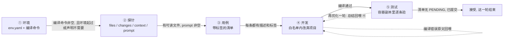

# specflow

给它一个项目目录和一段改动需求，它把活拆成五步做：搭容器环境、摸清代码、写验收用例、改真代码、在容器副本里逐条验。
每一步都落成人能打开的文件，过不了闸就退回上一步。做给要接手陌生项目的人用，也给想看清「AI 到底改了什么」的人用。

现状：可以完整跑通一条链路，但只在 Windows 11 + Docker Desktop + DeepSeek API 上实测过。
后端 231 条单测、前端 11 条、七页浏览器冒烟；没有 CI，也没有自动化端到端脚本。
代码都在 `master` 上。上一版叫 `v2-final`（tag），不是这条历史线的祖先，需要时按 tag 取。

## 五步与闸



闸的判据只有一份，在 `src/main/java/com/specflow/flow/Gates.java`；界面只显示它给出的那句话，不自己判断。
② 的 `changes` 是 ④ 的写白名单：要改的文件和要新建的文件都列在这里，漏列的文件 ④ 动不了。
⑤ 跑在项目副本 + 容器里，源码在验收阶段冻结；跑完要你点「接受」才算闭环。

## 装之前

- JDK 17（我这台是 17.0.6）
- Maven 3.9（实测 3.9.11）
- Node 18+ 和 npm：只有编前端需要
- Docker Desktop，且能跑 Linux 容器：① 起环境、⑤ 跑测试都要它
- 一个 OpenAI 兼容的模型接口和 key（默认配 DeepSeek）

## 构建

```bash
mvn clean package
```

产物是 `target/specflow.jar`，前端（Vite 的 dist）会被打进 jar 的 `static/`，一个进程就是全部。
依赖已经在本地仓库里之后可以加 `-o` 离线编。

只改 Java 时跳过前端：

```bash
mvn -o package -Dfrontend.skip=true
```

这个开关跳过 `npm run build` 和 dist 拷贝，所以前提是 `src/main/frontend/dist/` 已经有上一次的产物。

## 跑起来

拿仓库里的 `fixture/` 练手，它是一个零依赖的 Java 小项目，故意留了一个 bug，期望输出写在 `fixture/README.md`。

1. 配 key。在项目里建 `.specflow/local.env`，写一行：

   ```
   SPECFLOW_API_KEY=sk-...
   ```

   也可以用同名环境变量，环境变量优先。

2. 起引擎，项目指向 fixture：

   ```bash
   java -jar target/specflow.jar web -p fixture
   ```

   浏览器会打开 `http://127.0.0.1:8780`。不想自动开浏览器加 `--no-open`。

3. 页面上依次点：① 探测环境 → 起环境 → 冻结 → ② 存需求 → 跑探针 → 冻结 → ③ 生成用例 → 冻结 → ④ 跑开发 → 冻结 → ⑤ 跑测试 → 提交 → 接受。

   跑着的时候页头会出现「叫停」，它杀的是这一步起的整棵进程树。

4. 想看它改了什么：`fixture/.specflow/flow/<流程 id>/` 里有 `events.jsonl`（每条工具调用和输出）、`probe.json`、`cases.json`、`summary.md`。
   改之前的原文在 `snapshot/`。

没有 key 也能开界面，只是点「跑」的时候会告诉你缺什么。

## 配置

项目里只有两份配置是给人改的。

`<项目>/.specflow/project.yaml`：

```yaml
build:
  compile: "javac -d out/main src/main/java/com/demo/*.java"

llm:
  base-url: "https://api.deepseek.com"
  model: "deepseek-chat"
  api-key-env: "SPECFLOW_API_KEY"
  temperature: 0.2
  timeout-seconds: 180
```

`compile` 是 ① 的闸的第一条，也是 ④ 每次交差跑的那条命令。同一句要在宿主机和 Linux 容器里都能跑，
路径别写 `\`，容器里那是转义符。

`llm` 只用到 chat completions 一个接口，换别家就改 `base-url` 和 `model`。工具调用不走 function-calling，
是纯文本围栏解析，所以对模型的要求是「能照格式吐代码块」，不需要它支持工具协议。

`<项目>/.specflow/env.yaml` 是 ① 的产物，也可以手写。它是「环境长什么样」的声明，引擎按它渲染 compose：

```yaml
image: "eclipse-temurin:17-jdk"
workdir: "/work"

dependencies:
  db:
    image: "mysql:8.0"
    env:
      MYSQL_ROOT_PASSWORD: "root"
      MYSQL_DATABASE: "app"
    healthcheck: "mysqladmin ping -h 127.0.0.1 -uroot -proot"

env:
  DB_HOST: "db"
  DB_PORT: 3306

init:
  - "mvn -q -DskipTests compile"
  - service: "db"
    command: "mysql -h127.0.0.1 -uroot -proot app"
    stdin: "sql/schema.sql"

reset: "mvn -q flyway:clean flyway:migrate"
```

几个容易踩的点：`init` 里的命令跑在 app 容器（非 root，装不了系统包），
要在依赖容器里跑就写 `service:`；`stdin` 指的是项目里的文件，由引擎搬进容器喂给命令的标准输入；
`reset` 在 ⑤ 每条用例开始前跑一次，用来把数据恢复到一个已知状态。

剩下的旋钮都在命令行或界面上，不写进配置文件：

```bash
java -jar target/specflow.jar web --port 8790      # 换端口，默认 8780
java -jar target/specflow.jar env init -p fixture --timeout 20   # 「这一步我愿意等多久」，单位分钟
```

服务只监听 `127.0.0.1`（`web/App.java` 里写死的），也不做鉴权。别改成 0.0.0.0。
密钥只从环境变量或 `.specflow/local.env` 读，不回显、不进日志、不进容器副本。

## 命令行

```bash
java -jar target/specflow.jar web [--port 8780] [--no-open] [-p 项目目录]
java -jar target/specflow.jar env prepare [-p 项目目录]               # 只铺配置，不动 docker
java -jar target/specflow.jar env init    [-p 项目目录] [--timeout 分钟]
java -jar target/specflow.jar env reset   [-p 项目目录] [--timeout 分钟]
java -jar target/specflow.jar env status  [-p 项目目录]
java -jar target/specflow.jar env down    [-p 项目目录] [--purge]     # 收干净，--purge 连流程数据一起删
java -jar target/specflow.jar version
```

`env down` 按项目名标签扫容器、网络、卷，不只是停主环境那一条 compose，所以 ⑤ 的测试沙箱也会被收掉。

## 数据落在哪

```
<项目>/.specflow/
  project.yaml  local.env  env.yaml
  flow/current                              当前流程 id
  flow/<id>/flow.json                       五格状态 + facts
  flow/<id>/events.jsonl                    统一归档日志，行号就是事件 id
  flow/<id>/probe.json  cases.json  summary.md
  flow/<id>/snapshot/                       写之前的原文
  flow/<id>/runs/<runId>.jsonl              每次运行的逐轮留档
  flow/<id>/env/<时间戳>/compose.yaml       渲染出来的 compose
  flow/<id>/checkpoint.json                 运行级断点，可以删

~/.specflow/logs/engine.log                 引擎日志，10MB 滚 5 份
~/.specflow/recent.json                     最近打开的项目
~/.specflow/projects.json                   每个项目的环境状态
```

没有数据库。想查「刚才到底发生了什么」，直接看 `events.jsonl`。

## 测试

```bash
mvn -o test "-Dfrontend.skip=true"           # 后端 231 条
cd src/main/frontend && npm ci && npx vitest run   # 前端 11 条
```

浏览器冒烟需要本机有 Chrome 和 playwright（playwright 不是项目依赖）：

```bash
cd src/main/frontend
SPECFLOW_PLAYWRIGHT=file:///D:/tools/node_modules/playwright/index.mjs node tests/smoke.mjs
```

它自己起一个 jar，用真 Chrome 走七个页面，对账三件事：后端声明的页头按钮是不是真画出来了、
能点的按钮点下去有没有发请求、换项目之后五格状态有没有跟着换。另外核对五格都声明了「叫停」，
而没有活跑的时候页面上不许出现它。

端到端（真模型 + 真 Docker，把 fixture 整条链跑一遍）没有写成脚本，是手工点的，一次两百秒左右。

## 已知限制

- Windows 优先。开发、测试都在 Windows 11 上做的，路径做了跨平台处理，但没在 macOS 或 Linux 上真跑过。
- HTTP 接口没有鉴权，靠绑定回环地址兜底。多用户、远程访问都不支持。
- 同一时刻只允许一段运行，第二次点会回 409 并告诉你先等或者叫停。
- 叫停杀得掉进程，杀不掉正在飞的模型调用：那一轮要等它回来。
- 容器里必须自带构建工具（mvn、javac 之类）。引擎会在容器里真构建一次来确认，没装会拦在 ①，
  提示去改 `image` 或 `init`。
- 实际验证过的项目都是 Java/Maven 一类。别的语言要自己写 `compile`，没测过。
- 模型只接过 DeepSeek 和一处 OpenAI 兼容端点。小模型偶尔吐不合规的代码块，引擎会当场补问两次，两次都不合规就收场。
- 没有 CI、没有覆盖率门槛。文档里的数字是手工跑出来的。
- Maven 版本号还是 `2.0.0`，`specflow version` 也打印 2.0.0（历史遗留，`v3` 曾经只是分支名）。
- 还没有 License 文件。

## 目录结构

```
src/main/java/com/specflow/
  core/    事件流、原子写、路径、进程、模型、预算、日志
  flow/    五格状态机、闸、动作表、运行登记、快照、崩溃恢复
  env/     compose 渲染、起停、命令守卫、宿主机编译、容器能力校验
  agent/   ReAct 循环、上下文压缩、打转检测、工具（读、写、改、跑、交差）
  test/    测试沙箱、用例清单、逐用例预算、高危命令审批
  web/     HTTP 路由、会话、静态资源、错误口径
src/main/frontend/   Vue 3 + Vite，无组件库，手写 CSS
fixture/             练手用的零依赖 Java 项目
docs/                架构、接口、界面、交付记录、系统说明书
```

## 文档

先看 `docs/README.md`，那里写了每份文档回答什么问题、按什么顺序读。

| 文件 | 内容 |
| --- | --- |
| `docs/README.md` | 文档地图与阅读顺序 |
| `docs/SYSTEM.html` | 系统说明书，用浏览器打开。设计为什么是这样，逐包逐类带源码 |
| `docs/ARCHITECTURE.md` | 十二条不变量、目录落点、事件协议、崩溃恢复 |
| `docs/API.md` | 每个接口的形状、状态码、闸拒绝长什么样 |
| `docs/UI.md` | 页面结构、状态词表、组件 |
| `docs/DELIVERY.md` | 交付记录：验过什么（带原始输出）、没做什么 |
| `DESIGN.md` | 色板、字级、间距、动效。改界面前看 |

## 贡献

见 `CONTRIBUTING.md`。里面写了构建和测试怎么跑、加一个动作或工具要动哪几处、注释该怎么写。

## License

还没有。要商用、要再分发，先开个 issue 跟我确认。TODO：选一个，MIT 或 Apache-2.0。
